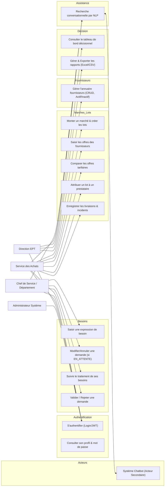
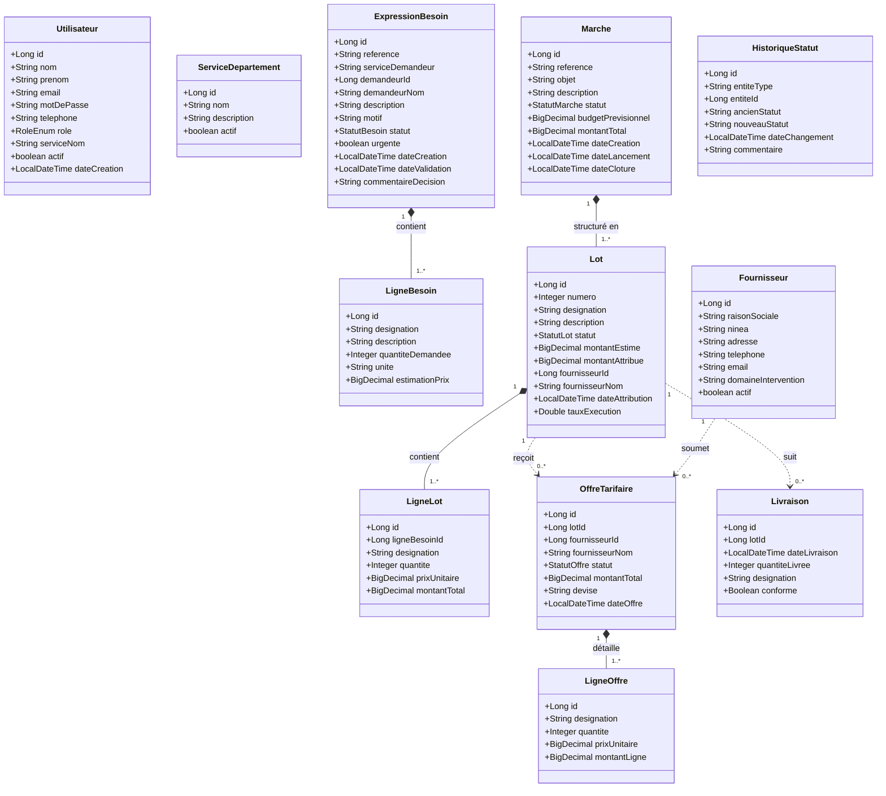
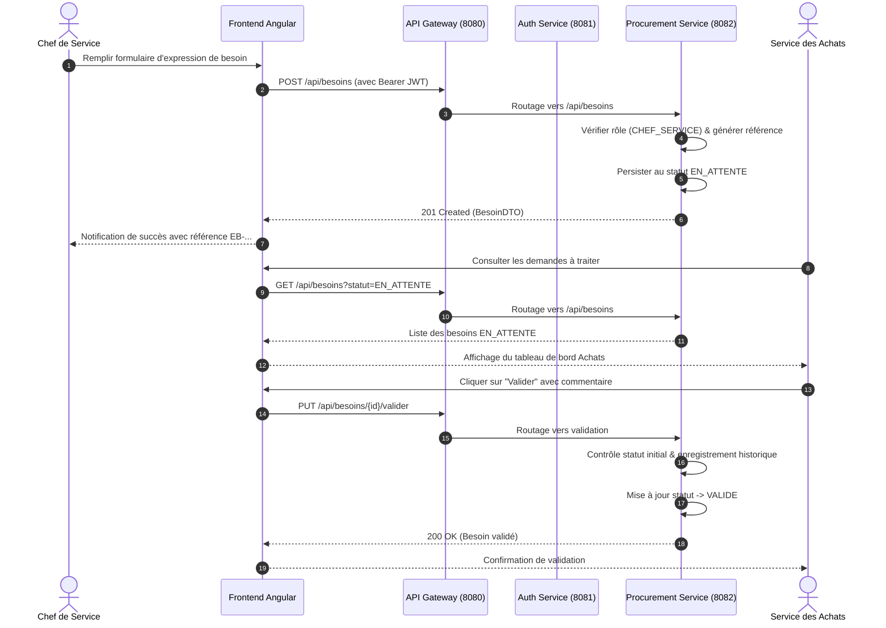
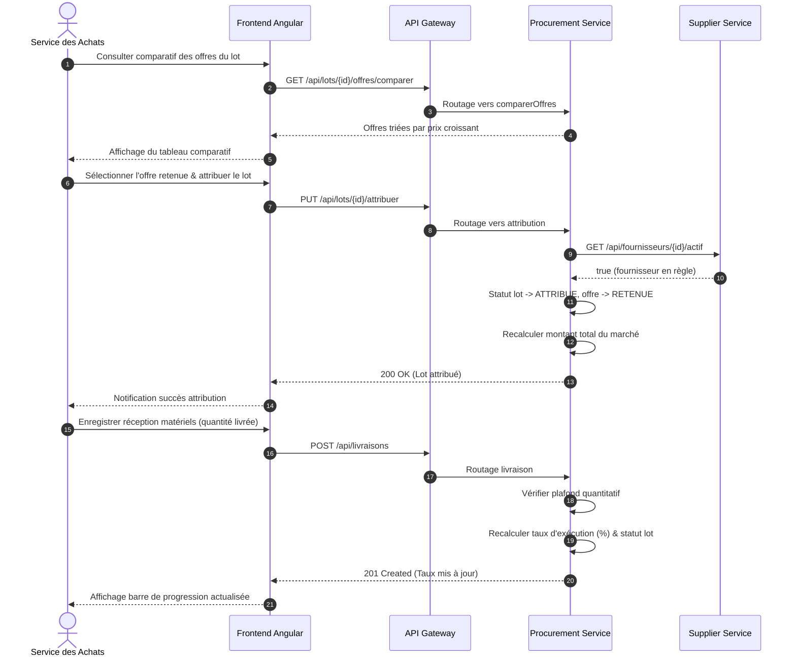
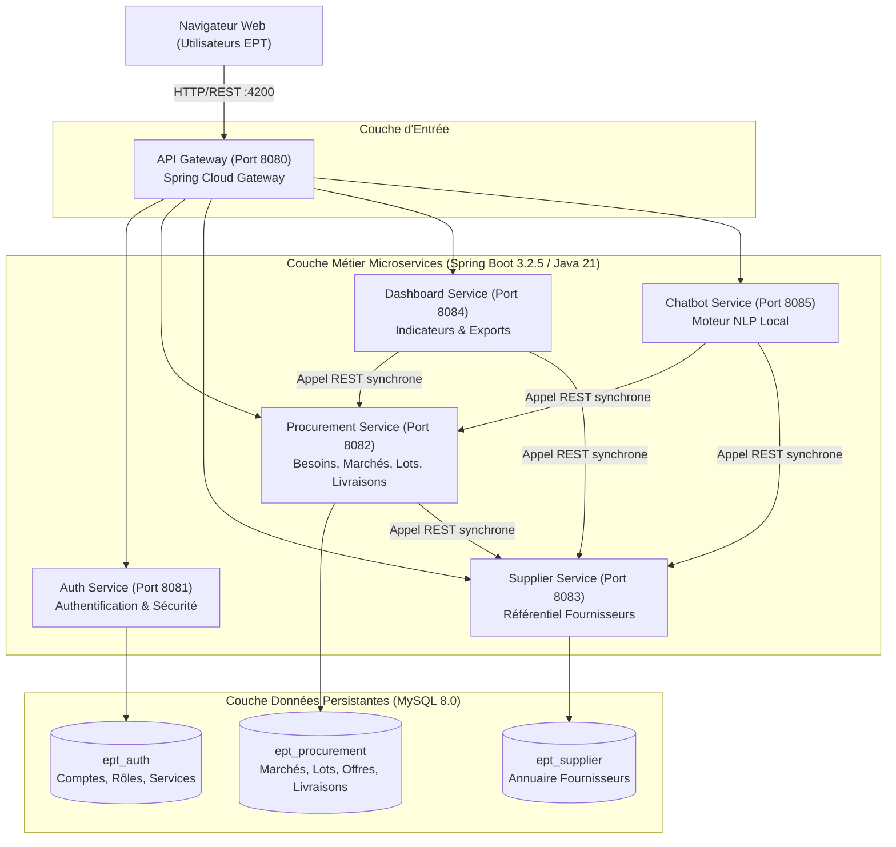

# Modèles et Diagrammes UML

## Projet EPT : Système de Management et de Suivi des Marchés

---

## 1. Diagramme de Cas d'Utilisation Global

---

## 2. Diagramme de Classes Métier du Domaine

---

## 3. Diagrammes de Séquence

### 3.1 Cycle d'une Expression de Besoin (Création -> Validation)

### 3.2 Attribution d'un Lot et Enregistrement de Livraison

---

## 4. Diagramme de Déploiement et Composants

